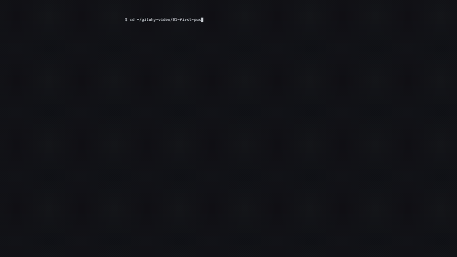
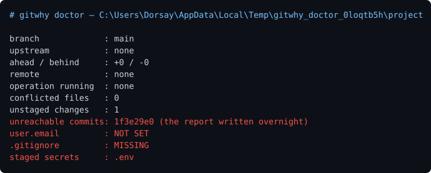

# gitwhy

When a git command fails, `gitwhy` does not repeat the error back at you: it reads your
repository's current state — which branch you are on, how far behind you fell, which
files conflict, whether a rebase is half-finished — and produces the fix for *that* state.
The matching is deterministic, not an LLM; it works with no network. It never runs
destructive commands for you, it only shows them and says what they delete. Measured
scenario accuracy is in the table below.

> **Status:** all 12 scenarios work, measured with 18 fixtures. 39 tests, no runtime
> dependencies.


Every frame above is real output — `python tools/demo.py` puts a temporary repository
into a broken state, actually runs the commands, and draws the bytes it captured. No line
was written by hand.

### Demo video — 3 minutes

[](https://github.com/Sanixaa23/gitwhy/releases/download/v0.1.0/gitwhy-demo.mp4)

### ▶ [Download the full 3 minutes, with narration](https://github.com/Sanixaa23/gitwhy/releases/download/v0.1.0/gitwhy-demo.mp4)

The moving image above is a **silent 12-second preview** — it is a GIF, and a GIF
cannot carry audio. The full video is narrated, but **GitHub will not play it in the
browser**: it refuses to preview a blob this size, and it serves the raw file as
`application/octet-stream` with `nosniff`. The link above is the asset [attached to
the v0.1.0 release](https://github.com/Sanixaa23/gitwhy/releases/tag/v0.1.0), so it
downloads; open it in any player and the narration is there.

That preview is the opening beat: `git push` fails, git's error sits there, and the
explanation appears underneath with nothing else typed.

It covers the first failed push, a rebase conflict and the scenario-ordering rule, a
staged `.env`, the two modules the design rests on, the accuracy matrix, the safety
suite, and the install. The same rule as the GIF applies and is the reason the video
exists in this form: every character on screen came out of `tools/video_capture.sh`
running the real commands against real repositories, and `tools/video_render.py` only
draws those files. It is drawn rather than screen-recorded, which is a different thing
from faked — nothing was typed into a transcript by hand. The narration is synthetic
(ElevenLabs), generated from the script in [docs/CUE-SHEET.md](docs/CUE-SHEET.md), and
it decides the cut: each segment's picture lasts exactly as long as its line, so
re-generating one line re-times both sides.

## Install

One line, no dependencies:

```bash
pipx install git+https://github.com/Sanixaa23/gitwhy
```

Without pipx, `pip install git+https://github.com/Sanixaa23/gitwhy` works too; pipx is
preferred because it installs the tool into its own environment.

Check the install:

```bash
gitwhy --version
gitwhy doctor
```

Requires **Python 3.9+** and **git 2.23+** (the `git switch` suggestions need it). Nothing
else is needed to run it — `dependencies` in `pyproject.toml` is empty. No network, no
account, no configuration.

From source, for development:

```bash
git clone https://github.com/Sanixaa23/gitwhy
cd gitwhy
pip install -e ".[dev]"
python -m pytest -q
python tests/test_rules.py        # the confusion matrix
```

Development and the tests need **git 2.28+** (`git init -b`). Producing the demo GIF also
needs `pillow`.

To try it without installing:

```bash
PYTHONPATH=src python -m gitwhy.cli doctor
```

## Usage

```
gitwhy                           # explain the last failed git command
gitwhy explain --stderr err.txt  # explain the given error output (- = stdin)
gitwhy capture -- git push       # run the command, explain it if it fails
gitwhy doctor                    # repo health: upstream, user.email, staged secrets
gitwhy shell-init bash           # wrapper that fires automatically when git fails
gitwhy --ai                      # rewrite the explanation with an LLM (optional)
```

`gitwhy doctor` lists a repository's problems at a glance; the red lines are the ones to
deal with:



This image was not captured by hand either: `python tools/doctor_image.py` builds a real
repository with four separate problems, runs `gitwhy doctor`, and draws the output.

### Shell wrapper (optional)

Install it and you no longer type `gitwhy`: it fires on its own when git fails.

```bash
gitwhy shell-init bash >> ~/.bashrc     # for zsh: gitwhy shell-init zsh >> ~/.zshrc
```

Remove it by deleting that line, or with `unset -f git` for the current session.

The wrapper does not touch git's output; it records only the command and the exit code.
Because the error **text** is not recorded, the decision comes from repository state plus
the command you ran — which still finds 10 of the 12 scenarios. The two it cannot reach
are the ones that depend on the remote's answer: push rejection (7) and protected branch
(8).

To get those two as well, turn on stderr copying:

```bash
export GITWHY_TEE=1
```

**It has a cost:** stderr is no longer attached to the terminal, so git stops printing
progress bars (`Writing objects: ...`) — git only shows progress while stderr is a
terminal. That is why it is off by default.

The wrapper stays out of the way for commands you interrupt with `Ctrl-C` (exit code 130),
and if `gitwhy` is not on PATH it steps aside silently rather than breaking git.

Unit tests cannot cover the wrapper, because there is no shell there.
[tools/wrapper_test.sh](tools/wrapper_test.sh) installs it for real and tries it against
real git failures; CI runs that under both bash and zsh, in both modes:

```bash
bash tools/wrapper_test.sh
GITWHY_TEE=1 bash tools/wrapper_test.sh
```

### AI mode (optional, off by default)

```bash
export ANTHROPIC_API_KEY=sk-...
gitwhy --ai                 # or: gitwhy --ai --level normal
```

**The LLM does not make the decision.** By the time it runs, the scenario has already
been matched deterministically and the explanation already exists; the model only
rewrites that text for the reader's level. If there is no key, no network, or the request
fails, you get the template and a one-line note saying so.

The rewrite is then **vetted before it is shown**. The answer is thrown away, and the
template shown instead, if it introduces a destructive command that was not in the
original, drops the warning from one that stayed, or waters a warning down so it no
longer says what gets deleted. `tests/test_ai.py` tests that gate against every command
in `DESTRUCTIVE_COMMANDS`, with no network involved.

This is the answer to "did you just ask an LLM?": no — the matching is deterministic, the
LLM only rewrites the prose, and it cannot talk you into running something dangerous.

## Scenarios

| # | Scenario | Status | Detection signal |
|---|---|---|---|
| 1 | Detached HEAD | ✅ | `# branch.head (detached)` **and** no operation in progress |
| 2 | Merge conflict | ✅ | `u ` lines > 0, or `MERGE_HEAD` |
| 3 | Rebase left half-finished | ✅ | `.git/rebase-merge` or `rebase-apply` |
| 4 | Cherry-pick / revert in progress | ✅ | `CHERRY_PICK_HEAD` / `REVERT_HEAD` |
| 5 | No remote at all | ✅ | `fatal: No configured push destination.` |
| 6 | Remote exists, no upstream | ✅ | `has no upstream branch` |
| 7 | Push rejected (behind) | ✅ | `! [rejected]` / `fetch first` (**not `branch.ab`**) |
| 8 | Committed to the wrong branch | ✅ | `! [remote rejected]` / `pre-receive hook declined` |
| 9 | `node_modules` staged | ✅ | a staged path component is a dependency directory |
| 10 | `.env` / key staged | ✅ | staged file named `.env`, `*.pem`, `id_rsa` |
| 11 | Local changes block a checkout | ✅ | `would be overwritten` |
| 12 | Lost commit | ✅ | in the last 10 reflog entries, unreachable from every ref |

Scope stops here. There is no claim that this "solves every git error".

**There is deliberately no state-based form of scenario 8.** The signal "main has unpushed
commits" cannot be told apart from the perfectly normal state of someone working alone —
the `neg_main_ahead` fixture shows exactly that. So scenario 8 is detected only by the
remote's refusal. Not producing false positives comes before widening coverage.

## Measured scenario accuracy

`tests/fixtures.py` builds a **real** git repository for each scenario and puts it into
that broken state; the rule engine then predicts by reading that repository. The matrix is
the output of `python tests/test_rules.py`.

```
truth \ prediction   01   02   03   04   05   06   07   08   09   10   11   12 none
01                    1    0    0    0    0    0    0    0    0    0    0    0    0
02                    0    1    0    0    0    0    0    0    0    0    0    0    0
03                    0    0    1    0    0    0    0    0    0    0    0    0    0
04                    0    0    0    2    0    0    0    0    0    0    0    0    0
05                    0    0    0    0    1    0    0    0    0    0    0    0    0
06                    0    0    0    0    0    1    0    0    0    0    0    0    0
07                    0    0    0    0    0    0    1    0    0    0    0    0    0
08                    0    0    0    0    0    0    0    1    0    0    0    0    0
09                    0    0    0    0    0    0    0    0    1    0    0    0    0
10                    0    0    0    0    0    0    0    0    0    1    0    0    0
11                    0    0    0    0    0    0    0    0    0    0    2    0    0
12                    0    0    0    0    0    0    0    0    0    0    0    2    0
none                  0    0    0    0    0    0    0    0    0    0    0    0    3

12 scenarios, 18 fixtures, 18/18 correct (100%)
```

The last row and column are **negative controls**: a clean repository, a repository after
`commit --amend`, and main with an unpushed commit. None of the three may match any
scenario; that diagonal cell means "produced no false positive". There are more fixtures
than scenarios because one scenario can be reached several ways: cherry-pick and revert
land on the same row, a blocked checkout and a blocked merge land on the same row, and
`reset --hard` and a deleted branch land on the same row.

GitHub Actions re-measures this matrix on every PR.

## Safety

1. The tool never runs a destructive command on its own. It prints the command; copying
   it is the user's decision.
2. If a `--run` option is ever added, destructive commands stay out of it. Only
   reversible ones (`git switch`, `git stash push`, `git branch`) could run automatically.
3. Every suggestion states plainly what the command deletes **permanently**.
4. `tests/test_safety.py` enforces this: it checks that every template containing a
   destructive command carries a warning line, and that the auto-run list holds no
   destructive command. It also guarantees by test that `context.py` contains no
   repo-modifying git command.

## Architecture

```
capture.py   records / reads the last failed command
context.py   read-only git queries -> a single Context object
rules.py     (context, error text, command) -> scenario id. Pure, no I/O, no LLM
explain.py   scenario id + context -> text, from the scenarios/*.md templates
ai.py        optional: rewrites that text, and vets the answer before showing it
cli.py       argparse, 5 subcommands
```

Most of the context comes from one command:

```
git status --porcelain=v2 --branch
```

That single call yields `branch.head` (the literal `(detached)` when detached),
`branch.upstream`, `branch.ab +ahead -behind`, the conflicted files on `u ` lines, and the
unstaged changes on `1 `/`2 ` lines.

### Eight findings the fixture tests produced

**1. Check rebase before detached HEAD.** In the middle of a rebase conflict `git status`
reports `(detached)` *and* `rebase-merge` at the same time. An engine that checks detached
first tells a mid-rebase user something entirely wrong. Correct order: operation in
progress → conflict → error text → failed command → state.
`test_rebase_checked_before_detached` catches anyone breaking that order.

**2. Reading the first line of the error is not enough.** In a merge conflict git's first
output line is `Auto-merging a.txt`; the real error is further down. `rules.error_lines()`
scans every line for `CONFLICT`, `error:`, `fatal:`, `! [rejected]`.

**3. "No upstream" is not one error but two states.** With no remote configured git says
`fatal: No configured push destination.` (scenario 5); with a remote but no tracking
branch it is a different message and a different fix (scenario 6,
`git push -u origin <branch>`).

**4. After a rejected push there is NO "you are behind" signal.** Git does not update the
remote-tracking ref after a rejected push: `branch.ab` still reads `+1 -0`. The real
behind count only appears as `-1` after `git fetch`, and `context.py` cannot fetch
(read-only). Scenario 7 is therefore the single exception: it decides from the error text,
not from state. `test_behind_count_reads_zero_after_rejected_push` keeps that on the
record.

**5. `git check-ignore` is useless on a staged path without `--no-index`.** By default
check-ignore consults the index and reports a path that is in it as "not ignored" even
when a rule matches. Scenarios 9 and 10 query exactly the staged paths; without the flag
the answer is always empty and the "a `.gitignore` rule exists but the file was staged
anyway" case is never seen.

**6. The error-marker list is a gate.** `rules.error_lines()` only lets through lines
carrying one of `ERROR_MARKERS`; `match()` never sees the rest. The protected-branch
rejection line is `! [remote rejected]`, which matches neither `"! [rejected]"` nor
`"[rejected]"` — `remote ` sits in between. The rule was correct and the pattern was
correct, and scenario 8 still matched nothing, twice. The rule: **markers must be the
loosest fragment (`rejected`), scenario patterns stay narrow.**
`test_text_driven_fixtures_pass_the_marker_gate` catches this class of bug.

**7. The read-only way to find an unreachable commit is `rev-list --no-walk`.**
`git fsck --lost-found` writes a `.git/lost-found` directory, so it modifies the repo.
`git rev-list --no-walk <shas> --not --all` gives the same answer in one call, writing
nothing and needing no cap: of the listed commits, those no ref can reach.
`commit --amend` also leaves the old commit unreachable, but that is deliberate — when the
newer reflog entry is `commit (amend)` the commit is skipped (the `neg_amend` fixture
confirms it).

**8. The shell wrapper cannot record the error text, because the text is already on
screen.** The first version recorded only the exit code, and the result was that the five
text-driven scenarios (5, 6, 7, 8, 11) matched **nothing** through the wrapper. The user
saw `fatal: No configured push destination.` on screen while gitwhy said "no matching
scenario". The fix was not to pipe stderr — that silences git's progress bars — but to
**feed the failed command to the rules**: `git push` + no remote → scenario 5, `git push`
+ remote but no upstream → scenario 6, `git checkout` + an unstaged file → scenario 11. No
trade-off, and coverage went from 7/12 to 10/12. A recorded command is accepted only from
the same repository and the last 10 minutes, so a stale record is never mistaken for the
answer to today's command.

## Repository map

| Path | What it is |
|---|---|
| [src/gitwhy/context.py](src/gitwhy/context.py) | read-only state collector |
| [src/gitwhy/rules.py](src/gitwhy/rules.py) | the pure matcher: state, text and command in, scenario id out |
| [src/gitwhy/explain.py](src/gitwhy/explain.py) | template filling, plus the destructive-command rules |
| [src/gitwhy/scenarios/](src/gitwhy/scenarios) | the 12 hand-written templates |
| [tests/fixtures.py](tests/fixtures.py) | builds a real broken repository per scenario |
| [tools/video_setup.py](tools/video_setup.py) | builds the three demo repositories |
| [docs/VIDEO.md](docs/VIDEO.md) | the 2:20 demo shot list |
| [docs/DEVPOST.md](docs/DEVPOST.md) | submission draft |
| [docs/SOURCEHACKS.md](docs/SOURCEHACKS.md) | the event's rules, verified from the official listing |

## Reproducing the demo recording

The GIF and the images live in the repository; there are two ways to change them.

**Everywhere, Windows included — the recording program (recommended).** The steps are in
the `STEPS` list in [tools/demo.py](tools/demo.py); adjust the holds there.

```bash
pip install pillow
python tools/demo.py              # docs/demo.gif + docs/demo.cast
python tools/doctor_image.py      # docs/doctor.svg + docs/doctor.png
```

The tool prints the total length and warns if it leaves the 20–30 second window.
`--cast-only` produces just the asciicast, with no Pillow needed.

**Linux / macOS / WSL — a real terminal recording.** asciinema has no Windows build, so
this path only works there:

```bash
asciinema rec docs/demo.cast --cols 96 --rows 36 --overwrite \
    --idle-time-limit 2 -c "bash tools/demo_flow.sh"
agg --font-size 15 --theme github-dark docs/demo.cast docs/demo.gif
```

[tools/demo_flow.sh](tools/demo_flow.sh) types the flow itself, so the recording can be
taken unattended; no typos, no retakes. Both paths work in a temporary directory and leave
your own repository alone.

The recorded flow, 29.7 seconds:

| Seconds | What you see |
|---|---|
| 0–4 | `git rebase main` → `CONFLICT` and `error: could not apply` |
| 4–14 | `gitwhy` → what happened, the repo's state, three options, and the warning on the destructive one |
| 14–17 | the conflict is resolved, `git add a.txt` |
| 17–21 | `git rebase --continue` → `Successfully rebased and updated refs/heads/feature.` |
| 21–30 | `gitwhy doctor` → a clean repository |

## License

MIT
